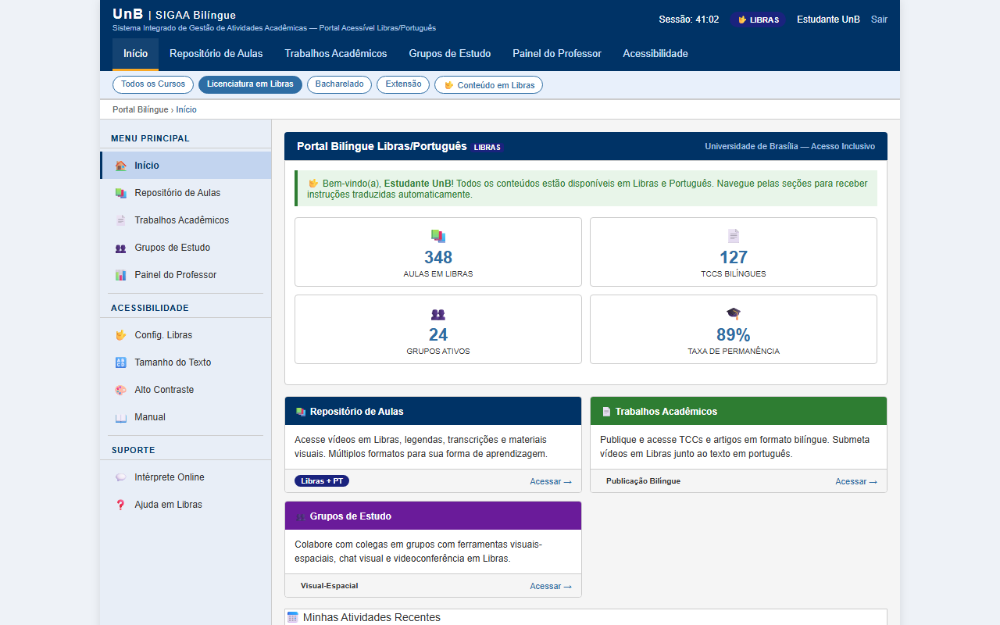

# SIGAA Bilíngue: protótipo de portal acessível em Libras/Português

Protótipo acadêmico de front-end que imagina como um portal universitário no estilo do SIGAA poderia funcionar para estudantes surdos e sinalizantes: navegação com vídeos-guia em Libras, modo visual "apenas sinalizantes", alto contraste e ajuste de fonte. É uma página estática (HTML, CSS e JavaScript puro), sem back-end.

> **Aviso:** este é um projeto de estudo e conceito de acessibilidade. **Não é um produto oficial da Universidade de Brasília (UnB) nem do SIGAA**, não tem vínculo com essas instituições e não se conecta a nenhum sistema real. O login é simulado no próprio navegador: nenhum dado digitado é enviado a lugar algum. Números exibidos na tela (aulas, TCCs, taxa de permanência) e menções a selos como WCAG AAA são conteúdo ilustrativo do protótipo, não resultados medidos.



## Funcionalidades

- **Login simulado** com dois modos: Português ou "Apenas Sinalizantes (Libras)". Qualquer matrícula e senha preenchidas liberam o acesso.
- **Vídeos-guia em Libras** que tocam automaticamente em um player flutuante ao entrar nas seções Início, Grupos de Estudo e Manual, e param ao trocar de seção. Os vídeos ficam hospedados no Cloudinary.
- **Página de Acessibilidade** com:
  - ativar ou desativar o player de Libras;
  - posição do player (inferior direito, inferior esquerdo, superior direito);
  - tamanho da fonte (14, 16 ou 18 px);
  - contraste normal, alto contraste ou tema escuro.
- **Atalhos na barra lateral** para alternar tamanho do texto e alto contraste.
- **Seções navegáveis** (sem recarregar a página): Início, Repositório de Aulas (com vídeos do YouTube em modal), Trabalhos Acadêmicos, Grupos de Estudo, Painel do Professor, Acessibilidade e Manual do Usuário.

## Como rodar

Não há dependências nem build. Sirva a pasta por HTTP:

```bash
git clone https://github.com/oliveirahipx/portal-libras.git
cd portal-libras
python -m http.server 8000
```

Abra <http://localhost:8000>, preencha qualquer matrícula e senha e clique em **Entrar no SIGAA**. Os vídeos precisam de internet, porque vêm do Cloudinary e do YouTube.

## Estrutura

```
index.html   todas as telas (login e seções do portal) em uma única página
style.css    layout, modo Libras, alto contraste e tema escuro
script.js    login simulado, troca de seções, player de Libras e controles de acessibilidade
docs/        captura de tela usada neste README
```

## Tecnologias

HTML5, CSS3 e JavaScript (ES6+), sem frameworks. Vídeos externos via Cloudinary e YouTube.
